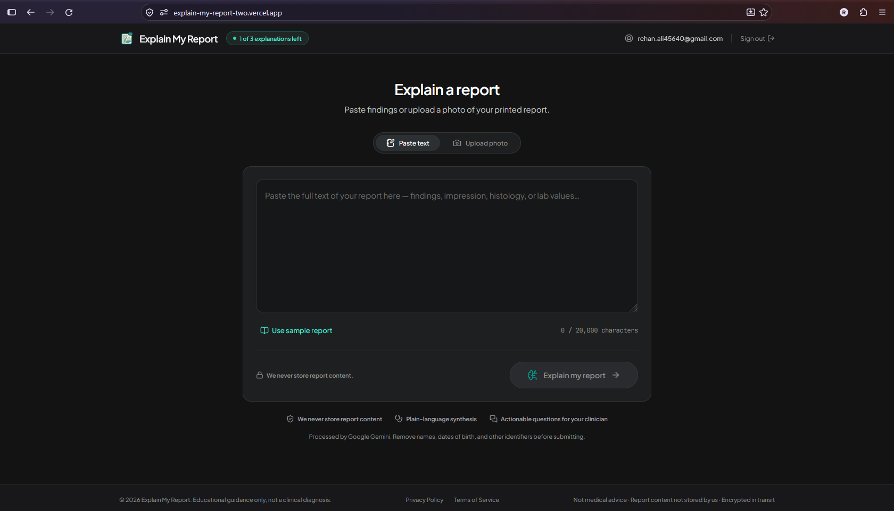
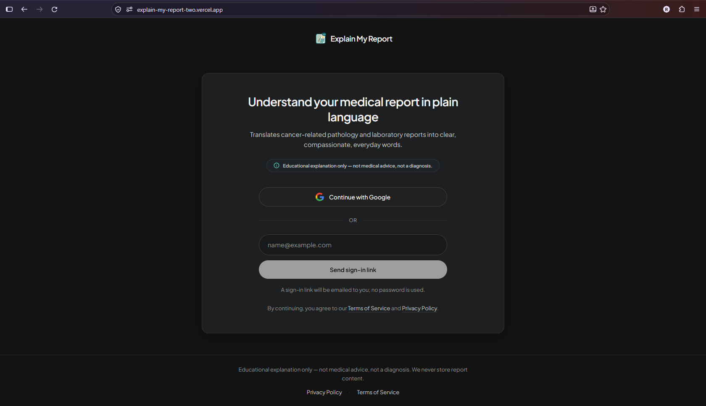
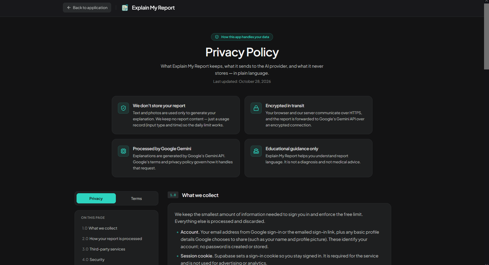
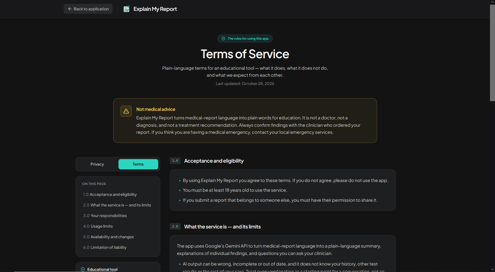

<div align="center">


# Explain My Report

**Plain-language explanations of cancer-related medical reports — educational, not diagnostic.**

[](https://explain-my-report-two.vercel.app/)
[](https://nextjs.org/)
[](https://ai.google.dev/)
[](https://supabase.com/)

<br />

<p align="center">
  
</p>

</div>

---

## What it is

**Explain My Report** is a free web app that helps patients and their families understand the complex language in cancer-related pathology and laboratory reports. Users can securely sign in, paste report text or upload a photo of a printed report, and receive a calm, grounded, plain-language translation of what the document actually says.

> **Important:** It is **not** a doctor, a diagnosis, or a treatment recommendation. It is a translation and communication tool designed to help patients understand clinical findings and prepare thoughtful questions for their next oncology appointment.

---

## Why it exists

Medical reports are written for clinicians, not patients. Technical terms like *invasive ductal carcinoma*, *lymphovascular invasion*, *margins negative*, or *HER2 equivocal* can be terrifying and confusing—especially for someone awaiting answers.

Searching isolated terms online often leads to alarming, generic, or conflicting web pages. Furthermore, generic AI chatbots frequently overreach by attempting to stage cancer, predict prognoses, or give medical advice they are not qualified to offer.

Explain My Report fills that gap safely by adhering to strict boundaries:
- **Grounding:** Explains only what is explicitly written in the report.
- **Tone:** Clear, compassionate, everyday language.
- **Evidence:** Cites the exact source excerpt behind each finding.
- **Safety First:** Refuses to diagnose, stage, predict, or recommend treatment.
- **Doctor-Centered:** Generates practical questions to bring to the clinician.

---

## Application Showcase

### 1. Secure, Passwordless Sign-In
<p align="center">
  
</p>
Users sign in quickly without creating or remembering passwords, using either Google OAuth or a one-time email magic link.

---

### 2. Comprehensive Privacy & Terms
<p align="center">
  
  
</p>

Full transparency with built-in privacy guarantees and clear usage disclaimers.

---

## Key Features

- **Dual Input Options:** Paste report text directly (up to 20,000 characters) or upload a photo of a printed paper report (PNG, JPEG, WebP up to 4 MB).
- **Plain-Language Summary:** Immediate high-level overview explaining the report category and primary takeaways.
- **Structured Findings with Status Tags:**
  - `Routine` — Expected, benign, or negative for disease.
  - `Needs attention` — Flagged as significant or abnormal for care team discussion.
  - `Unclear` — Ambiguous, incomplete, or illegible text that is deliberately not guessed at.
- **Verifiable Excerpts:** Every explained point links back to verbatim phrases in the source report.
- **Care Team Questions:** Tailored questions to discuss at the next appointment, equipped with a one-click copy button.
- **Zero Report Persistence:** Refreshing, navigating away, or signing out immediately discards the explanation and report content.
- **Fair-Use Rate Limiting:** Enforces a rolling 3-explanation limit per 24 hours per account to ensure fair availability.

---

## How It Works

```
[ User signs in ]
       │
       ▼
[ Paste text OR Upload photo ] ──► [ Rate limit check (Supabase) ]
                                                │
                                                ▼
                                    [ Google Gemini 3.5 API ]
                                                │
                                                ▼
                                    [ Strict Schema & Excerpt Validation ]
                                                │
                                                ▼
                                    [ Plain-Language Explanation & Questions ]
```

1. **Authentication:** The user logs in via Google OAuth or an emailed magic link.
2. **Submission:** The user pastes text or uploads a report image.
3. **Quota Reservation:** A lightweight timestamped usage record is logged in Supabase.
4. **Structured AI Processing:** The report is analyzed by Google's Gemini API according to strict schema guidelines.
5. **Hallucination Prevention:** Quoted excerpts are validated against original text; ungrounded statements are automatically removed.
6. **In-Memory Rendering:** Output is displayed on the screen only and is never stored on the server.

---

## Safety Boundaries

- **Not medical advice:** Explain My Report is strictly an educational tool.
- **Not a diagnosis:** It does not determine disease stage or prognosis.
- **Not a treatment plan:** It never suggests therapy, medications, or clinical actions.
- **AI validation required:** Output should always be reviewed with the prescribing physician.
- **Not for emergencies:** In urgent medical situations, contact local emergency services immediately.
- **Adult use only:** For adults aged 18 and older.

---

## Privacy & Data Protection

- **No report storage:** Neither medical texts nor uploaded photos are retained by the application.
- **Minimal audit logging:** Only the input category (text or photo) and timestamp are tracked to maintain daily limits.
- **No tracking or sales:** Zero ads, zero tracking cookies, and zero third-party data broker sales.
- **Infrastructure:**
  - AI analysis handled via **Google Gemini API**.
  - Authentication and fair-use quotas managed by **Supabase**.
  - Hosted globally on **Vercel**.

---

## Tech Stack

- **Framework:** [Next.js](https://nextjs.org/) (App Router, React 19)
- **Styling:** [Tailwind CSS v4](https://tailwindcss.com/)
- **AI / Multimodal:** [Google Gemini API](https://ai.google.dev/) (`gemini-3.5-flash-lite`)
- **Backend & Auth:** [Supabase](https://supabase.com/) (SSR Auth & PostgreSQL)
- **Icons:** [Lucide React](https://lucide.dev/)
- **Validation:** [Zod](https://zod.dev/)
- **Testing:** [Vitest](https://vitest.dev/)

---

## Disclaimer

*Explain My Report is an educational tool. It is not medical advice, not a diagnosis, and not a treatment recommendation. Always discuss your medical reports and questions with your physician or care team.*
